<div align="center">



<br />
<br />

**Swallow the order. Reach the portal. Try not to eat the city.**

A chaotic top-down puzzle game from Beura Labs. You are a black hole with a delivery contract.

<br />

<a href="https://blackhole-delivery.vercel.app">
  
</a>

<br />
<br />


<br />
<br />

[About](#about) &nbsp;·&nbsp; [Gameplay](#gameplay) &nbsp;·&nbsp; [How to play](#how-to-play) &nbsp;·&nbsp; [Worlds](#worlds) &nbsp;·&nbsp; [Scoring](#scoring) &nbsp;·&nbsp; [Run locally](#run-locally)

</div>

<br />

## About

Blackhole Delivery is a mobile-first arcade game where you play a tiny black hole that takes on delivery contracts. Each one asks for something specific: eight crates, two cars, a single truck, or one very large building. Swallow the order, grow as you go, then slide into the glowing portal to complete the delivery.

It runs in the browser with no install and no account. Open the link on a phone, tablet or laptop and start playing.

<br />

## Gameplay

<div align="center">



<sub>Downtown, Level 3. The artwork is an animated illustration of the in-game view.</sub>

</div>

<br />

Every level is a small city block full of things to swallow. The longer you play, the bigger your black hole gets, and the bigger the things you can pull in. Cars and trucks need real mass. Buildings and towers need even more.

- **Drag to move.** Your black hole follows your finger.
- **Eat to grow.** Anything close enough falls in, and every swallowed object adds mass.
- **Chain it.** Swallow objects in quick succession to build a chain for a higher score.
- **Hunt the order.** The top bar shows what the contract needs and how far along you are.
- **Find the portal.** Once the order is complete, a glowing portal opens. Reach it to deliver.

<br />

## How to play

1. Drag anywhere on the screen to move your black hole.
2. Get close to objects and they fall in. You grow with each one.
3. Swallow the items listed in the delivery order, then reach the glowing portal.
4. Objects that are too big will wait until you have grown enough.
5. Never swallow the white gift boxes. Each one costs you 5 seconds and breaks your chain.

Pedestrians will run away from you and complain loudly. That is part of the experience.

### Abilities

| Ability | What it does | Touch | Keyboard |
| --- | --- | :---: | :---: |
| **Pulse** | Pulls nearby objects in harder for a moment | PULSE button | `E` |
| **Dash** | Gives you a quick burst of speed | DASH button | `Space` |

Both abilities have a short cooldown, so use them when it counts.

### Object sizes

The objects in the world range from tiny to colossal. Your size decides what you can swallow.

| Tier | Examples |
| --- | --- |
| Micro | Cones, trash, pedestrians |
| Small | Crates, barrels, signs |
| Medium | Benches, cars, containers |
| Large | Trucks, buses |
| Massive | Buildings |
| Colossal | Towers |

<br />

## Worlds

There are 8 worlds with 2 levels each. Every world has its own look, its own set of objects and its own contracts. Later levels add time limits, wind and more gift boxes to avoid.

| # | World | Contracts |
| :-: | --- | --- |
| 1 | Storage Yard | 8 crates · 6 barrels |
| 2 | Downtown | 20 objects · 2 cars (timed) |
| 3 | Industrial Zone | 12 crates (timed) · 2 containers |
| 4 | Port | 14 crates (timed, windy) · 1 truck |
| 5 | Metropolis | 30 objects (timed) · 1 building |
| 6 | Future City | 2 buses (windy) · 3 gold bars (timed) |
| 7 | Orbital Facility | 35 objects (timed, windy) · 3 trucks |
| 8 | The Impossible Delivery | 3 buildings · 1 tower (windy) |

The Delivery Map in the menu shows every world and the stars you have earned in each.

<br />

## Scoring

Each level awards up to three stars.

| Stars | How to earn them |
| :-: | --- |
| ★ | Complete the delivery |
| ★★ | Complete it within the level's par time |
| ★★★ | Beat par time with zero penalties |

The results screen after each level shows your score, time, number of objects swallowed, final mass, best chain, penalties and near misses.

<br />

## Settings

| Setting | Options |
| --- | --- |
| Music | On or off |
| Sound FX | On or off |
| Vibration | On or off |
| Quality | Low, Balanced, High, Ultra |

Quality controls the render resolution, the number of background stars and how many objects can be on screen. If the game feels slow on an older phone, drop it to Low.

<br />

## Progress and privacy

Your stars and settings are saved in your browser's local storage. There are no accounts, and nothing is sent to a server. Clearing site data or switching browsers resets your progress.

The page loads the Baloo 2 font from Google Fonts. If it can't load, the game falls back to a rounded system font.

<br />

## Built with

| | |
| --- | --- |
| Language | Vanilla JavaScript, HTML and CSS |
| Rendering | HTML5 Canvas 2D |
| Audio | Web Audio API, with generated sound effects and music |
| Storage | Browser local storage |
| Hosting | Vercel |

The whole game lives in a single `index.html` file with no frameworks, no dependencies and no build step.

<br />

## Run locally

```bash
git clone https://github.com/SatyajitBeura2468/Blackhole-Delivery.git
cd Blackhole-Delivery
```

Open `index.html` in any modern browser. To use a local server instead:

```bash
python3 -m http.server 8000
```

Then visit `http://localhost:8000`.

<br />

## Repository

| Path | Purpose |
| --- | --- |
| `index.html` | The complete game |
| `assets/banner.svg` | Animated header artwork |
| `assets/launch-button.svg` | Animated play button |
| `assets/gameplay.svg` | Animated gameplay illustration |

<br />

## License

Blackhole Delivery is proprietary software. All rights are reserved by Satyajit Beura. The game's code, name, interface and artwork may not be copied, modified, redistributed or used to create derivative works without written permission.

<br />

<div align="center">

Built by **Beura Labs**

<a href="https://blackhole-delivery.vercel.app">blackhole-delivery.vercel.app</a>

</div>
